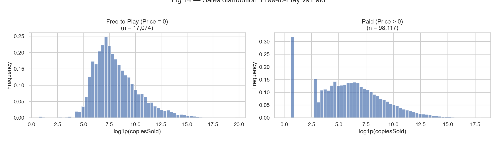
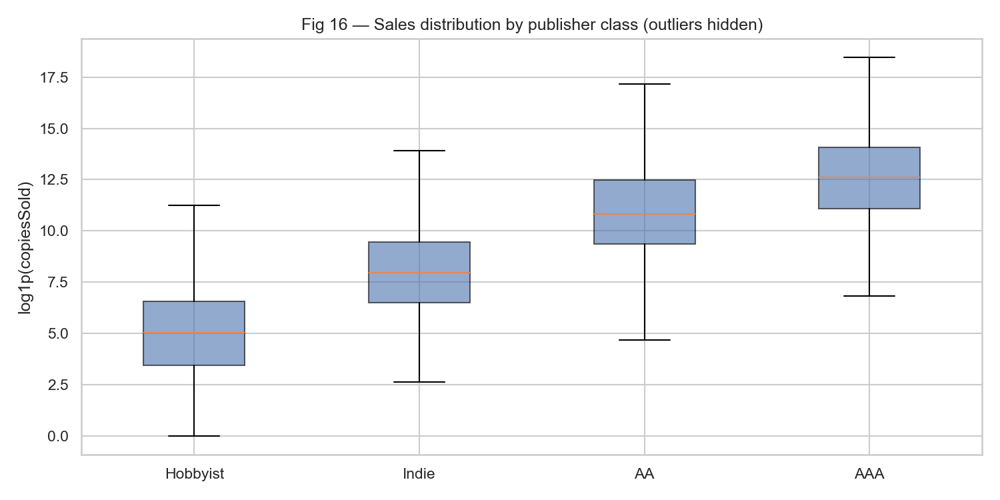

# Steam Game Sales Prediction

**CIS 5450 Big Data Analytics · University of Pennsylvania · Spring 2026 · 4-person team project**

Can we predict how many copies a Steam game will sell from information available on its store page? We merged two public datasets into a **115,289-game** panel, built a **14-step preprocessing pipeline**, ran **permutation-based hypothesis tests**, and compared linear, regularized, PCA, tree-based, and neural-network models on a log-transformed sales target.

> This is a curated copy of the team repository ([Arjian-Ma/CIS5450-FINAL-PROJECT](https://github.com/Arjian-Ma/CIS5450-FINAL-PROJECT)), kept here to document my contribution. Raw data is not included.

---

## My contribution: hypothesis testing

I owned the statistical inference part of the project ([`notebooks/04_hypothesis_testing.ipynb`](notebooks/04_hypothesis_testing.ipynb), [`src/hypothesis/tests.py`](src/hypothesis/tests.py)).

**Why permutation tests?** The target, `copiesSold`, is extremely right-skewed (skewness ≈ 70; median ≈ 600 copies vs. 343M for the top title). Even after a `log1p` transform the tails are non-normal, so instead of t/F tests I used simulation-based permutation tests (10,000 permutations), which only assume exchangeability under H₀.

| # | Question | Test statistic | Result |
|---|---|---|---|
| 1 | Do free-to-play games sell more copies than paid games? | Difference in median log-sales | Δ median = **1.72** log units, p < 0.001 → **reject H₀** |
| 2 | Is a higher price associated with fewer copies sold? | OLS β on price (one-sided, H₀: β ≥ 0) | β = **+0.31**, p = 1.00 → **fail to reject**: no evidence of a negative price effect; higher-priced games tend to sell *more*, likely because price proxies for production quality |
| 3 | Does publisher class (Hobbyist / Indie / AA / AAA) affect sales? | Permutation ANOVA F-statistic | F = **20,702**, p < 0.001 → **reject H₀** |

Caveats documented in the notebook: sales are third-party estimates (noisier for small free games), the three factors are confounded with one another, so results are associational rather than causal, and a Bonferroni-adjusted α (0.017) leaves all conclusions unchanged.

<p float="left">
  
  
</p>

---

## Project overview

### Data
| Source | Rows | Content |
|---|---|---|
| Kaggle Steam Games dataset | ~115,000 | Store metadata: price, genres, tags, languages, reviews, release date |
| Gamalytic | 117,629 | Estimated copies sold, publisher classification |
| **Merged** (left join on App ID) | **115,289** | 47 raw columns → 97 features after preprocessing |

### Preprocessing pipeline (14 steps, [`src/data/preprocessor.py`](src/data/preprocessor.py))
Drop unused columns → drop null targets → parse release dates → count supported languages → parse owner ranges → one-hot genres, categories and tags → derived numeric features → handle Metacritic sparsity → ordinal-encode publisher class → frequency-encode developer/publisher → `log1p` skewed numerics → create log target.

A **leakage map** separates post-release features (reviews, playtime, CCU) from launch-time features so that the "predict at launch" model only uses information available before release.

### Modeling
| Model (validation set, log scale) | RMSE | R² |
|---|---|---|
| Mean predictor (baseline) | 2.98 | 0.00 |
| Linear regression | 1.76 | 0.65 |
| Ridge / Lasso | 1.76 / 1.77 | 0.65 |
| PCA (20 comp.) + Ridge | 2.05 | 0.53 |
| **XGBoost, top-60 RFE features (launch-time)** — test set | **1.54** | — |

The final XGBoost model has a **median absolute error of 441 copies**. The [error analysis](docs/error_analysis_findings.md) shows classic regression-to-the-mean on a heavy-tailed target: it over-predicts tiny games and under-predicts blockbusters. A Tweedie objective is proposed as the next step.

Publisher class is the single strongest predictor (OLS β ≈ 2.18 on the log scale, i.e. each tier ≈ 8–9× more copies).

---

## Repository structure
```
├── main.py                     # end-to-end pipeline runner
├── configs/config.py           # paths and flags
├── src/
│   ├── data/                   # loader + 14-step preprocessor
│   ├── features/               # feature engineering, RFE selection
│   ├── hypothesis/tests.py     # permutation tests (my module)
│   ├── models/                 # baseline, advanced, PCA, k-means, NN
│   └── evaluation/             # metrics
├── notebooks/                  # EDA, preprocessing, modeling, hypothesis testing, final report
├── docs/                       # data findings, RFE, error analysis write-ups
└── figures/                    # selected output plots
```

## How to run
```bash
pip install -r requirements.txt
# place games.csv, games-list.csv, games_merged.csv in Data/
python main.py --save          # full pipeline
python main.py --framing launch  # launch-time model only
```

## Tech stack
Python · pandas · NumPy · SciPy · scikit-learn · XGBoost · matplotlib / seaborn · Jupyter

## Team
Ziyan (Eileen) Li · Jiantang Ma · Jun Yu Chen · and one other teammate
